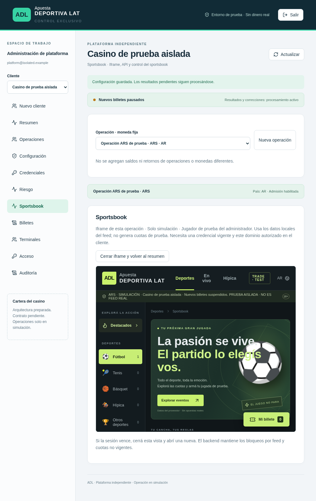

# Painel ADL — validação local e funcionalidades entregues

## Abrir sem iniciar nenhum worker

No Mac, dentro do checkout existente:

```bash
cd "$HOME/LSports" &&
git pull --ff-only origin feat/sportsbook-demo &&
npm run build &&
npm run demo:synthetic
```

Painel: `http://localhost:3101/control`.
Iframe do cassino de teste: `http://localhost:5174/demo/synthetic`.
Login **exclusivo da demonstração isolada**:
`admin@synthetic.local` / `Solo-pruebas-aisladas-2026`.
Não é uma conta da AWS ou do Argentina Demo.

O runner usa somente `.local-synthetic-demo`, identificado por manifesto. Não
carrega `.env`, não inicia worker, não consulta LSports e rejeita produção. Dados
anteriores da demonstração são preservados, inclusive bilhetes e auditoria. Para
ver o iframe **dentro do painel**, adicione explicitamente
`http://localhost:3101` aos domínios desse cliente sintético, mantendo o domínio
`http://localhost:5174` já autorizado. O painel não contorna a política de domínios.
A abertura exige credencial ativa; usa somente seu ID no backend, não o segredo.

## Entregue

- Login/logout existentes mantidos; erro de conexão e sessão expirada explícitos.
  Troca autenticada de senha exige a senha atual e encerra todas as sessões
  administrativas da conta. Senhas digitadas permanecem no formulário se houver
  erro e são apagadas ao concluir. Nenhuma senha é registrada em auditoria.
- Recuperação assistida: administrador da plataforma pode restabelecer o acesso
  do administrador de um cliente. Administrador de cliente não pode executar essa
  ação. Sessões administrativas antigas são revogadas; credenciais de integração,
  bilhetes e odds aceitas não mudam. Não há envio de e-mail configurado.
- Cadastro existente de clientes/operações mantido; nome do cliente editável na
  configuração, com escopo verificado no servidor.
- Terminal registrado/editado por operação, com nome, ID e estado. **O primeiro
  registro ativa a verificação do cadastro para POS nessa operação**: novos
  bilhetes/sessões exigem ID ativo. Operações sem cadastro preservam o contrato
  POS anterior. Registre todos os terminais existentes antes de habilitar seu uso.
  Suspensão não cancela bilhetes e não interrompe liquidação. Reenvio idempotente
  via integração backend conserva o bilhete já aceito. Registro não é atestado
  físico do dispositivo; hardware e APK real ainda precisam de homologação.
- Aba Sportsbook: sessão temporária e descartável com cliente/operação/moeda
  fixados no servidor; jogador `control-demo:<adminId>`, separado dos jogadores
  do cassino. Abre o iframe e volta ao resumo sem sair do painel. Web/móvel/POS
  usam o mesmo contrato existente e a validação financeira continua no backend.
- Aba Billetes: paginação de 30, busca por parte do ID ou jogador, detalhes com
  seleções, odds aceitas, resultados e revisões. Consulta usa SQL paginado, não
  carrega o histórico inteiro. Nada é somado entre operações ou moedas. Bilhetes
  legados em pontos continuam separados no fluxo legado existente.
- Estados de carregamento/erro, feed incompleto, sessão vencida; navegação em
  espanhol validada em 390px e tablet 1024px. Dados armazenados não são marcados
  como preços atuais. Não houve mudança de regras de preço, feed ou liquidação.

## Recuperação da conta de plataforma pelo responsável do servidor

Procedimento assistido local, sem endpoint público. Faça primeiro backup normal
recuperável de `control.sqlite` pelo processo operacional aprovado. Prepare um
arquivo JSON regular, pertencente ao operador, com permissão **0600**, fora do
repositório, contendo `action: "recover_platform_access"`, `email` e
`newPassword` (12–256 caracteres). Não use senha em argumentos ou histórico do
shell. Com `PLATFORM_DATA_DIR` apontando para o banco **existente** correto:

```bash
node --import tsx scripts/recover-platform-access.ts < /caminho/protegido/recovery.private.json
```

O comando exige arquivo privado regular em stdin e banco preexistente; não aceita
um pipe público nem imprime dados de entrada. Registra auditoria, revoga sessões
administrativas e preserva integrações e bilhetes. Não foi executado na AWS.
Após uso, mantenha o arquivo fora de sincronização/compartilhamento e aplique a
política local de retenção de segredos. Não forneça seu conteúdo por chat.

## Evidência dos testes e limites

- Build de API/web/worker (checagem de tipos; nenhum worker iniciado).
- Suíte de API/armazenamento: permissões, isolamento, CSRF, expiração,
  preview/domínios, terminais, recuperação CLI, bilhetes, liquidação e preservação
  de arquivos legados. Usa diretórios temporários e dados sintéticos explícitos.
- Navegador Chromium: login, clientes/operações, rotação, iframe autorizado e
  pai bloqueado, bilhete/comprovante, risco, busca/detalhes, terminal, preview no
  painel/retorno, logout, recuperação assistida e tamanhos móvel/tablet.
- Runner sintético: aceite/recusa, limites e concorrência, histórico,
  comprovante, liquidação e correção idempotentes, suspensão sem parar resultados.

Sem deploy, reinícios ou alteração dos workers LSports. Feed AMQP real, snapshots
atuais, odds reais na AWS e integração física com APK/POS permanecem sem validação
nesta etapa. O AMQP 403 segue no ticket #217525. Estes testes não o resolvem.

Prévia do ambiente **isolado com dados sintéticos**, sem conexão à LSports:


