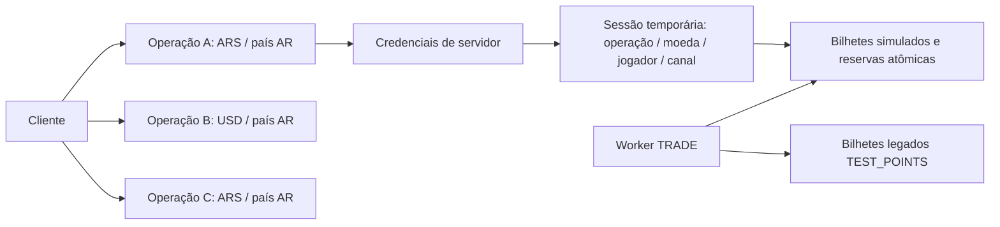

# Apuesta DEPORTIVA LAT — base administrativa multimoeda e risco

## Inventário e alcance efetivo

| Área | Implementado e validado | Limite atual |
| --- | --- | --- |
| Sportsbook | React/TypeScript responsivo, espanhol argentino, futebol/Hípica, mercados, bilhete, histórico e comprovante. Interface anterior reutilizada no iframe. | Sem dinheiro real; hardware Android/impressora não homologados. |
| LSports TRADE | Worker persistente, AMQP, snapshots, tipos Outright 37/39/41/42, diagnóstico, checkpoint, rate limiting e shutdown seguro. | A validação com fornecedor foi feita pelo operador no Mac. Testes desta etapa não consultam a LSports. Contrato UTC confirmado no chamado 217525: datas válidas sem fuso são normalizadas antes do SDK; veja docs/TRADE.md. |
| Bilhetes legados | SQLite, odds aceitas imutáveis, resultados, revisões, histórico e comprovantes preservados. | Permanecem em `TEST_POINTS`. Não foram migrados nem receberam moeda real/cliente/operação. |
| Controle | `/control`: plataforma e administrador de cliente, cadastro, isolamento, domínios, operações, credenciais, políticas, diagnóstico, risco e auditoria. | Gestão completa de contas, MFA/recuperação e segurança de produção ainda pendentes. |
| Multimoeda | Cliente → operações → credenciais; ARS/CLP/PYG/USD/VES, país separado, moeda fixa, sessões/bilhetes/limites/relatórios por operação. | Sem câmbio, agregação financeira entre operações ou carteira externa. |
| Admissão e risco | Validação no servidor, reserva atômica de limites, regras determinísticas, alertas, tratamento, suspensões e exposição. | Sempre simulação. Modelagem financeira completa/ledger e contrato do cassino não estão definidos. |

É uma base funcional testável, **não o produto comercial pronto para dinheiro real**. Os manuais comercial, técnico e operacional finais serão gerados após concluir/homologar o produto. Este documento registra o que pode ser executado agora e as pendências concretas.

## Modelo e isolamento



Cada operação tem UUID próprio, cliente, nome, país (código de duas letras), moeda e estado. Duas operações podem ter a mesma moeda; ainda assim, seus bancos, jogadores, limites, credenciais, risco e relatórios são separados. País não determina moeda: por exemplo, país AR com operação USD é permitido.

A moeda é imutável desde a criação, regra deliberadamente mais restritiva do que bloquear só após histórico: ela já faz parte das credenciais, sessões, idempotência e limites. Para mudar moeda, crie outra operação. Não existe rota para reatribuir bilhetes ou converter saldos.

A credencial e a sessão são vinculadas no servidor a `{clientId, operationId, currency}`. A sessão também fixa `playerId`, canal e terminal. Divergências enviadas pelo navegador/API são rejeitadas, não ignoradas. O jogador deve ser uma referência opaca **estável do cassino** entre web, celular e POS; não use ID da sessão como identidade. A sessão de iframe não pode trocar de jogador ou canal.

Canais: `web`, `mobile`, `pos`. POS exige `terminalId` de 8–128 caracteres alfanuméricos/`:_-`. Um terminal não é a identidade do jogador. Não há autenticação de hardware/atestado Android nesta etapa; a identificação vem do servidor autenticado do cassino. Não há integração com POSNET Lottery. A ponte antiga `/api/posnet/test/*` permanece só no modo local legado e é bloqueada no modo plataforma.

## Dinheiro exato, precisão e carteira

| Moeda | Casas decimais | Exemplo: valor principal → `stakeMinor` |
| --- | ---: | --- |
| ARS | 2 | 123,45 → `"12345"` |
| CLP | 0 | 123 → `"123"` |
| PYG | 0 | 123 → `"123"` |
| USD | 2 | 123,45 → `"12345"` |
| VES | 2 | 123,45 → `"12345"` |

A API comercial aceita importes como **strings decimais de inteiros em unidades menores**, nunca valores JSON de ponto flutuante. Soma, multiplicação de valores, exposição, acumulados e arredondamento usam `BigInt`. O limite do simulador é 100.000.000 unidades menores por bilhete, e o retorno individual é limitado a `Number.MAX_SAFE_INTEGER` unidades menores. Na fronteira com o motor legado de simulação, a conversão para inteiro JS é explicitamente limitada ao intervalo exato; a aritmética de retorno do motor já usa inteiros/BigInt. Relatórios agregados continuam em BigInt/strings e não perdem precisão.

Odds aceitas continuam fixadas em milionésimos (`oddsMicros`). O simulador usa arredondamento half-up para unidades menores; essa regra precisará ser homologada no contrato financeiro. Não há multiplicação de dinheiro por odds em ponto flutuante no fluxo comercial. Conversão de texto principal, formatação e previsão de retorno do iframe usam aritmética inteira. CLP/PYG não admitem casas fracionárias. Não há FX ou conversão automática.

Bilhetes novos têm `financialMode:"simulation"`, `testOnly:true`, moeda, cliente e operação persistidos no contexto do bilhete, canal e terminal. O motor interno reutilizado continua separado dos bilhetes legados; nenhum registro legado é reinterpretado como dinheiro. O escopo persistido é conferido ao restaurar/consultar, em vez de trocar silenciosamente sua moeda.

A carteira externa **não está implementada**: saldo é `null`, `status:"contract_pending"`, sempre com cliente/operação/moeda/jogador. Isso não é um saldo zero nem um saldo fictício inventado. `WalletScope`/`WalletTransactionScope` incluem cliente, operação, moeda, jogador, transação, idempotência e `amountMinor`. São limites internos de arquitetura, **não um contrato HTTP já acordado com o cassino**. Rotas `/wallet/*` retornam 501 sem debitar/creditar/estornar. O simulador não exige disponibilidade de saldo externo nem movimenta fundos.

## Limites autorizados e configuração da operação

A plataforma define uma política **por cliente e moeda** e se o cliente pode editar limites. Cada operação tem um segundo controle de permissão de edição. Ambos precisam autorizar o administrador do cliente. O cliente só pode editar suas próprias operações e torná-las mais restritivas do que a política autorizada.

Campos de política e operação:

- `minStakeMinor` e `maxStakeMinor`: mínimo/máximo global por bilhete; mínimo ≤ máximo.
- `maxReturnMinor`: teto adicional de retorno potencial simulado.
- `allowRepeatedTickets`: novos bilhetes do mesmo jogador no mesmo evento.
- `maxTicketsPerPlayerEvent`: inteiro positivo opcional; `null` = sem esse teto.
- `maxStakePerPlayerEventMinor`: acumulado opcional em unidades menores; `null` = sem esse teto.
- `sameEventMultiples:"blocked"`: separado dos bilhetes repetidos. Não pode ser habilitado até existir precificação explícita de seleções correlacionadas. O mesmo fixture com prefixos PreMatch/InPlay diferentes também não contorna esse bloqueio.

O limite efetivo intersecta a política atual e a configuração da operação. Reduzir a política passa a restringir novas admissões sem reescrever os bilhetes existentes. Uma interseção incompatível bloqueia novas admissões com mensagem clara, até correção administrativa. Alterações de limites registram autor, data e valores anteriores/novos.

A aceitação do bilhete, seu contexto e as reservas de limite ficam no **mesmo `BEGIN IMMEDIATE` SQLite** por operação. Processos concorrentes serializam a verificação e gravação; não verificam um contador e gravam o bilhete depois fora da transação. Uma múltipla reserva o valor integral do bilhete em cada evento envolvido, sem dividi-lo entre pernas. Cada evento é contado uma vez por bilhete.

Idempotência é escopada por cliente/operação/moeda/jogador. Um replay da mesma requisição retorna o bilhete aceito e não repete reservas/alertas. Alterar importe, seleções, canal ou terminal com a mesma chave é conflito, não nova aposta. A identificação de jogador não muda por canal ou terminal.

**Semântica de contagem desta etapa:** limites jogador/evento são acumulados por toda a vida do fixture, não por sessão/dia. Rejeições dão rollback integral e não contam. Cancelamentos/reembolsos/estornos de bilhetes já aceitos **não liberam automaticamente** quantidade ou valor acumulado; a reserva de admissão permanece. Resultados, correções e devoluções simuladas continuam sendo processados normalmente. Não existe cancelamento financeiro administrativo nesta API. A futura carteira/outbox deverá definir reservas financeiras e reversões; não confunda essa reserva de limite com reserva de saldo.

## Controle de risco determinístico

Há uma área **Riesgo** com atualização local a cada 5 segundos, filtros por operação, evento, jogador, gravidade e situação, visão global autorizada para a plataforma e valores separados por operação/moeda.

Regras configuráveis, sem IA:

1. Importe acima de um umbral absoluto.
2. Importe acima de um múltiplo da média dos últimos até 1000 bilhetes aceitos do jogador na operação, somente com o mínimo de histórico configurado.
3. Frequência de bilhetes por jogador em janela configurada (até uma hora).
4. Fragmentação: quantidade e acumulado do jogador no mesmo evento/janela.
5. Concentração de importe pendente por evento, mercado e seleção.
6. Exposição bruta potencial da operação acima de um teto.
7. Variação de odds em janela configurada, somente com duas versões distintas confiáveis e ordenadas da seleção.
8. Feed sem conexão/atualização confiável ou com seleções em quarentena de timestamps.

Cada regra tem estado habilitado, ação **alertar** ou **bloquear nova admissão**, gravidade e parâmetros. Inicialmente, as regras financeiras estão desabilitadas; saúde do feed gera alerta informativo. Um bloqueio automático de risco exige regra explicitamente habilitada com ação `block`, com auditoria de configuração e da decisão. Um alerta informativo não bloqueia. As proteções técnicas anteriores de preço/status/conexão/timestamps são obrigatórias, independem dessa configuração e não podem ser relaxadas pelo cliente.

Regras preventivas e suspensões são verificadas dentro da mesma transação de admissão/reserva. Uma rejeição por risco desfaz bilhete/contexto/reservas e grava evidência do **intento**, sem inventar um bilhete aceito. A regra de concentração por alvo só bloqueia novas jogadas relacionadas ao alvo; o teto de exposição da operação pode bloquear novas admissões em toda a operação. Mudar regras não modifica bilhetes aceitos.

Alertas contêm gravidade, motivo, primeira/última observação, cliente/operação/moeda, jogador quando pertinente, evento/mercado/seleção, início informado, estado ao vivo e atualização dos dados quando disponíveis. Bilhetes envolvidos são identificados; intentos rejeitados são identificados separadamente. Não se guardam credenciais ou payloads completos do fornecedor. Alertas ativos são deduplicados e novas evidências atualizam o mesmo caso. Fechar um caso não o recria a cada polling com evidência idêntica; nova evidência pode gerar outro caso. Listas de referência são limitadas a 100 bilhetes/50 eventos por alerta para limitar crescimento.

Tratamento: `new` → `review` → `closed` (também pode reabrir manualmente), responsável e observação obrigatória em cada alteração, com autor/data. Sem enviar notificações a terceiros. A auditoria de risco fica atomicamente no banco da operação e também é exibida na consulta administrativa combinada.

Ações manuais: suspender/reativar novas jugadas na operação, evento, mercado ou seleção, com motivo e auditoria. São respeitadas na API, iframe e sessões POS. O iframe mostra bloqueio administrativo por disponibilidade, sem alterar odds nem status original do fornecedor. Reativar um alvo não supera outros bloqueios ativos. Suspensão não interrompe resultados/liquidações. Não há ação automática de cancelar bilhetes, alterar odds aceitas, reter pagamentos ou atribuir derrota por suspeita.

### Exposição: hipóteses e limites

O painel separa:

- valor total apostado **pendente**;
- retorno potencial bruto;
- resultado líquido por cenário de resultado nas apostas simples;
- estimativas conservadoras para múltiplas e para a operação.

Para simples, cenários por seleção são calculados quando o operador declara aquele ID de mercado como **mutuamente exclusivo confirmado**. A lista começa vazia: não se deduz exclusividade de nomes. Sem essa confirmação, o painel indica hipótese não confirmada e não apresenta perda exata por cenário. Inclui cenário de resultado não listado e devolução integral. Mesmo com exclusividade declarada, os cenários não modelam dead heat, linhas sobrepostas, correlação entre mercados, probabilidades ou todas as regras especiais de liquidação.

Para múltiplas, calcula o produto das odds aceitas e supõe conservadoramente vitória de todas as pernas. Para a operação, soma os retornos potenciais de todos os pendentes como **cota bruta conservadora**, não como perda exata (resultados podem ser incompatíveis). A cota inferior do resultado líquido é apostado pendente menos essa cota bruta; o limite de perda conservadora é a parte negativa em módulo. A regra inicial de exposição compara o **retorno bruto potencial conservador**, não uma suposta perda estatística exata. A decisão inclui o próprio bilhete em admissão antes do commit, serializada com outras reservas concorrentes.

Não soma moedas nem operações diferentes. Filtros de alertas não restringem o cálculo da exposição da operação inteira. Não usa saldo de carteira, não estima disponibilidade de caixa e não é VaR/probabilidade de perda.

### Evidência de odds e datas

O histórico de preço só recebe amostras com disponibilidade, feed recente/conectado, versão explícita ordenada e evidência de normalização segura. O worker expõe essa evidência quando existe no histórico de mensagens/snapshot já aceito. Duas versões diferentes e confiáveis são necessárias; não basta observar o mesmo preço repetidamente nem inventar um preço anterior. Se essa evidência não existir (inclusive mercados sem trilha explícita), a regra de variação não é avaliada. O painel informa a limitação. Mantém-se uma janela local de 24 horas de amostras observadas; isso não substitui um histórico completo do fornecedor.

Datas HTTP/AMQP sem timezone agora usam UTC conforme confirmação expressa do fornecedor no chamado 217525, nunca uma subtração fixa. Nenhuma migração de timestamps foi repetida. Novas amostras não legitimam versões antigas em quarentena. Início de evento é exibido como já informado pelo feed; ausência é explícita.

## Segurança, armazenamento e permissões

- `PLATFORM_ENABLED=false` (padrão) preserva o modo local antigo. **Não publique esse modo como serviço comercial**, pois suas rotas de teste antigas não autenticam jogadores.
- `PLATFORM_ENABLED=true` bloqueia as rotas anônimas antigas `/api/events`, `/api/tickets`, `/api/diagnostics/*` e `/api/posnet/test/*`. Valores inválidos da flag abortam, em vez de desabilitar a proteção silenciosamente.
- O administrador da plataforma cadastra clientes, vê a visão global autorizada, define políticas e permissões e suspende clientes. O administrador do cliente só acessa seu cliente/operações, configura o que foi autorizado, credenciais, risco e auditoria próprios. Papéis são verificados no servidor; alterar IDs no navegador não concede acesso.
- Senhas scrypt com salt, nenhuma conta padrão; sessão administrativa opaca de 8 horas com hash no banco, cookie HttpOnly/SameSite=Strict, Secure em HTTPS, restrito a `/api/control`; escritas com Origin exato e CSRF. Login tem limite persistente de 10 tentativas/15 minutos por IP/email. Configuração de proxy/limite distribuído é pendência de produção.
- `.runtime/platform/control.sqlite`: clientes, operações, políticas, contas, hashes, sessões, auditoria administrativa.
- `.runtime/platform/clients/<cliente>/operations/<operação>/tickets.sqlite`: bilhetes novos simulados, contexto imutável, reservas, resultados, risco, preços e auditoria de risco. Não usa o banco legado para atribuir moedas reais.
- `.runtime/platform/credentials/<UUID-da-chave>.key`: segredo permanente 0600, diretório 0700. O painel e as respostas administrativas mostram metadados; **nunca o segredo**. Hash da chave aleatória de 256 bits no banco. Entrega ao backend do cassino depende de canal seguro entre administradores de servidor; cofre/entrega automatizada ainda pendentes.
- Rotação/revogação invalidam chave anterior e suas sessões/códigos. Arquivos revogados são preservados para política futura de retenção; não autenticam mais.
- Checkpoint, `.env`, banco de bilhetes legado e backups anteriores mantêm seus caminhos. API/worker precisam do mesmo diretório; um único worker escreve o checkpoint. Suspensões não impedem reconciliar todos os bancos, inclusive operações suspensas e o banco legado.
- Auditoria é durável, mas não imutável contra administrador do filesystem. Retenção/exportação/serviço externo auditável são pendências.

## API e iframe entregues

Prefixo do servidor do cassino/iframe: `/api/integration/v1`. A chave permanente fica **só no backend do cassino**, nunca no APK/JS/query string/logs.

```http
POST /api/integration/v1/embed-sessions
Authorization: Bearer <chave da operação, mantida no servidor>
Content-Type: application/json

{"clientId":"UUID_CLIENTE","operationId":"UUID_OPERACAO","currency":"ARS","playerId":"jogador-opaco-estavel","parentOrigin":"https://casino.example","channel":"web"}
```

Retorna `iframeUrl` com código de uso único no fragmento e prazo de 60 segundos. O iframe troca por token de 15 minutos vinculado à operação/moeda/jogador/canal, remove o fragmento e guarda token só na memória. Não depende de cookies de terceiros. Ao expirar ou recarregar, o backend do cassino gera nova sessão. POS usa `channel:"pos"` e `terminalId`; mobile usa `mobile`.

O HTML comercial é servido pela API em `/embed/<cliente>/<operação>/sportsbook`, com CSP `frame-ancestors` dos domínios exatos autorizados do cliente. Sem domínios, `'none'`. `/control` usa `'none'` e `X-Frame-Options:DENY`. HTTPS exato, sem caminhos/curingas; HTTP só em localhost/loopback. Alterar domínios invalida sessões/códigos; pausar admissão sem mudar domínios preserva acesso ao histórico. O proxy não pode remover/substituir esses headers nem servir um HTML estático alternativo nessas rotas.

```html
<iframe src="URL_RETORNADA_PELO_BACKEND_DO_CASSINO"
 title="Apuesta DEPORTIVA LAT — simulador deportivo"
 width="100%" height="900" style="border:0"
 sandbox="allow-scripts allow-same-origin allow-modals"></iframe>
```

| Integração v1 | Comportamento |
| --- | --- |
| `POST /embed-sessions` | Só chave do servidor; cliente/operação/moeda/parentOrigin verificados. |
| `POST /embed-exchange` | Código único, cliente e operação da URL; Origin da própria aplicação. |
| `GET /context` | Operação, moeda, canal, configuração e carteira não conectada, sem segredos. |
| `GET /events` | Projeção local com suspensões administrativas por operação; sem consultas ao fornecedor. |
| `POST /tickets` | `clientId`, `operationId`, `currency`, `stakeMinor` string, seleções e Idempotency-Key; canal/terminal fixos na sessão. |
| `GET /tickets`, `GET /tickets/:id`, `GET /tickets/:id/receipt` | Só jogador daquela operação. Nas chamadas com chave de servidor, `playerId` na query; no iframe, vem da sessão. |
| `/wallet/*` | 501, contrato pendente; nenhum movimento financeiro. |

Administração: `/api/control/login`, `/session`, `/logout`, `/clients`, `/clients/:id/operations`, `/clients/:id/limit-policies/:currency`, `/clients/:id/operations/:operationId/credentials`, `/report`, `/diagnostics`, `/risk`, `/risk/config`, `/risk/suspensions`, `/risk/alerts/:alertId`, `/audit`. Diagnóstico/risco leem o estado local: não disparam snapshots, não alteram assinaturas nem ignoram `retryAt`.

## Procedimento único de atualização no Mac

1. Ctrl+C na aplicação; aguarde shutdown e liberação do lock. Não apague `.env`, `.runtime`, backups, SQLite ou checkpoint. Não execute a migração de timestamps novamente.

```sh
cd ~/LSports
git switch feat/sportsbook-demo
git pull --ff-only origin feat/sportsbook-demo
npm ci
npm run build
npm test
```

2. Acrescente **ao `.env` existente**, preservando as variáveis LSports:

```dotenv
PLATFORM_ENABLED=true
PLATFORM_PUBLIC_ORIGIN=http://localhost:3001
PLATFORM_DATA_DIR=.runtime/platform
PLATFORM_BOOTSTRAP_EMAIL=
PLATFORM_BOOTSTRAP_PASSWORD=
```

Preencha email e senha própria de 12–256 caracteres somente no arquivo local ignorado. Não use `VITE_*`, argumentos de comando ou chat para segredos.

3. Apenas na primeira criação da conta do painel:

```sh
npm run platform:bootstrap
```

Recusa substituir administrador existente, não mostra senha nem consulta o fornecedor. Remova `PLATFORM_BOOTSTRAP_PASSWORD` do `.env` depois. Esse bootstrap cria um armazenamento administrativo novo, **não** migra timestamps/bilhetes legados.

4. `npm run dev`; abra **http://localhost:3001/control**. Crie cliente e administrador, domínios, uma ou mais operações com país/moeda, políticas/limites e credenciais próprias. Abra o iframe com sessão gerada pelo backend. O Vite na porta 5173 continua a prévia do frontend local; use a origem da API para HTML comercial e CSP por cliente. É necessário build para servir `/control` e `/embed`.

5. Os dois bilhetes antigos continuam no banco legado; para visualizá-los pela interface local anterior, volte a `PLATFORM_ENABLED=false` e reinicie. Não os associe arbitrariamente a uma operação/moeda. O worker continua processando seus resultados pela rotina normal. Se a primeira parada da versão anterior deixar lock, use somente o procedimento verificado de `--inspect`/recuperação de lock em [TRADE.md](TRADE.md); não refaça a migração.

## Validação e pendências do produto

Testes Node cobrem autenticação, CSRF, isolamento cliente/operação/moeda/jogador, moeda adulterada pelo navegador, mesma moeda em operações distintas, política autorizada, correlação bloqueada, acumulados de múltiplas, canais, cancelamento sem liberação automática, idempotência, precisão ISO e inteiros grandes. Processos Node independentes competem por limites e por exposição preventiva para provar serialização, rollback e preservação das reservas. Testes de risco cobrem cenários, alertas informativos/preventivos, histórico insuficiente, frequência/fragmentação, concentração, tratamento/auditoria, suspensão e liquidação preservada, além de datas ambíguas ignoradas no histórico de odds. Há regressão de dois bilhetes legados/configuração/checkpoint/backups em diretórios temporários.

`npm run validate:platform-ui` acrescenta teste Playwright/Chromium isolado: login/cadastro pelo painel, operação/moeda, chave fora do DOM, iframe entre origens e CSP bloqueando pai não autorizado, sessão, bilhete/comprovante, risco e tela de 390 px. Requer Playwright/Chromium disponíveis e aceita `PLAYWRIGHT_MODULE`/`CHROMIUM_EXECUTABLE`; é opcional no Mac. Dados sintéticos são explicitamente isolados, nunca fallback do modo conectado. Não valida carteira, fornecedor real ou hardware.

Para concluir o produto comercial:

1. Homologar esta base no Mac, nos cassinos e em Android WebView/POS reais; definir identidade de jogador/terminal e provisionamento seguro. A integração de impressão nativa não foi entregue nesta etapa.
2. Definir o contrato de carteira: moeda/unidades e arredondamento, saldo, débito/crédito idempotentes, reservas, estorno, conciliação, timeouts, erros, correções e responsabilidades. Depois implementar ledger/outbox/inbox, recuperação de falhas e compensações. Hoje não existe movimento de dinheiro nem transação distribuída com cassino.
3. Confirmar oficialmente o fuso HTTP com a LSports, homologar pacotes/mercados/resultados/cobertura, quotas e direitos comerciais de redistribuição. Não relaxar rejeição de datas sem evidência contratual.
4. Completar ciclo de contas (troca/recuperação de senha, MFA, revogação de usuário), cofre/entrega de segredos, retenção/exportação de auditoria, controles de risco homologados e modelagem adicional de correlações/dead heats/linhas/múltiplas. A lista de mercados mutuamente exclusivos precisa confirmação operacional.
5. Preparar produção: HTTPS/proxy/CSP, backups e restore testados, banco/particionamento adequados ao volume, HA/fencing do worker, isolamento de falha por operação, rate limiting distribuído, observabilidade/alertas e testes de carga/pentest. A base atual pressupõe um host e filesystem compartilhado; leitura de carteira/exposição não é balanceamento financeiro real.
6. Definir requisitos comerciais, jurisdicionais/licenças, KYC/idade/autoexclusão/jogo responsável, privacidade e suporte conforme a operação contratada. Homologar com os participantes; só então habilitar dinheiro real e produzir os manuais finais baseados no produto entregue.

Resultado da entrega: `npm test` com **118 testes aprovados**, build completo aprovado e os dois roteiros de navegador (`validate:platform-ui` e `validate:local-ui`) aprovados com Chromium. O bootstrap foi executado em diretório temporário: criou a conta uma vez, recusou sobrescrita e não imprimiu o segredo. Nenhuma validação nova de conexão com o fornecedor ou de hardware é afirmada.

### Diagnóstico seguro de credenciais e HTTP 401

O painel exibe **o ID, nunca o segredo**. A geração grava a chave completa em
`PLATFORM_DATA_DIR/credentials/<ID>.key` (diretório padrão `.runtime/platform`,
arquivo 0600). A rotação gera **outro ID e outro arquivo**, revoga a chave anterior
e suas sessões; o arquivo antigo é preservado, mas não autentica mais. Não copie
um UUID, nome, caminho, aspas ou o texto `Bearer` como se fossem a chave.
O backend do cassino envia `Authorization: Bearer <conteúdo completo do novo arquivo>`.
Nunca coloque a chave permanente no iframe, console, chat, URL ou argumentos do shell.
O esquema Bearer aceita caixa indiferente; tokens com aspas ou espaços internos são rejeitados.

Execute na raiz do repositório, com a API rodando, substituindo apenas `ID_NOVO_DO_PAINEL`
pelo UUID da credencial ativa (não pelo segredo):

```sh
npm run diagnose:integration -- --credential-id ID_NOVO_DO_PAINEL --client-id 941e6249-4e84-4154-a71e-1b15d9983ca3 --operation-id 6685c19e-9f27-4769-a2c2-772abd4053d0 --currency ARS --player-id demo-001 --parent-origin http://localhost:5173 --channel web --probe
```

O diagnóstico lê a chave diretamente do arquivo no servidor e confere formato,
hash persistido, revogação e vínculo cliente/operação/moeda, abrindo SQLite somente
para leitura. Não altera credenciais, bilhetes, checkpoints ou migrações. `--probe`
cria somente um código temporário de incorporação, sem mostrá-lo nem apostar; sem
essa opção, não faz chamadas HTTP. Só permite API HTTP em loopback, não segue
redirecionamentos e tem timeout de 10 segundos. Não consulta LSports.
`--key-file /caminho/arquivo.key` testa um arquivo alternativo sem passar seu conteúdo
na linha de comando; não remove aspas nem normaliza silenciosamente uma chave inválida.

A saída informa a etapa: `credential.read`, `credential.persistence`,
`authorization.build` ou `embed-session.request`. Uma falha sem HTTP informa
`httpStatus:null`, tipo de exceção limitado e códigos conhecidos como ENOENT,
EACCES, ECONNREFUSED ou timeout; nunca a exceção original, headers ou tokens.
Isso não presume indisponibilidade da API: `/control` responder 200 é compatível
com erro de entrada/header, credencial desconhecida ou falha de outra requisição.
Se a conferência local passa e o POST dá 401, confira se **a API em execução usa o
mesmo PLATFORM_DATA_DIR** e a versão atual, além do arquivo da credencial nova.
403 indica conferir escopo e domínio autorizado (`http://localhost:5173` exato).
Compartilhe apenas essas linhas sanitizadas, nunca o arquivo `.key`.

### Página local completa · Argentina Demo

Na configuração já validada do Mac (`PLATFORM_ENABLED=true`, origem pública da API
`http://localhost:3001`, domínio autorizado `http://localhost:5173`), execute:

```sh
npm run build
npm run dev:embed
```

Abra **http://localhost:5173/demo/argentina**. Pare antes o `npm run dev` anterior:
esses dois comandos disputariam as portas e o lock do mesmo worker. O novo comando
inicia a API, o worker existente e um servidor exclusivo da demonstração, substituindo
apenas o Vite nessa execução. Não cria clientes, operações, credenciais ou assinaturas.
Não modifica `.env`, `.runtime`, backups ou bilhetes, nem executa migrações.

A página incorpora o sportsbook completo servido pela API; a criação da sessão
ocorre no backend local, lendo o arquivo da credencial ativa
`29338d81-0a16-4377-94f0-1be91386ccbf.key` dentro de
`PLATFORM_DATA_DIR/credentials` (padrão `.runtime/platform/credentials`). O escopo é
fixo: cliente `941e6249-4e84-4154-a71e-1b15d9983ca3`, operação Argentina Demo
`6685c19e-9f27-4769-a2c2-772abd4053d0`, ARS, jogador `demo-001`, canal web.
O navegador recebe somente uma URL com código temporário de uso único. Nunca recebe
a chave permanente. O botão “Abrir / renovar sesión” gera uma nova sessão temporária.
As operações financeiras continuam em simulação; apostas de teste aceitas podem
ser persistidas no histórico dessa operação pela rotina normal existente.

O servidor de demonstração não faz parte do build/publicação, recusa
`NODE_ENV=production`, escuta somente loopback e verifica Host e Origin.
Não habilita CORS, não aceita escopo/credenciais enviados pelo navegador, não segue
redirecionamentos e não publica respostas brutas de erro. Não abra pelo IP da rede
ou por `127.0.0.1`: use a origem autorizada exata `http://localhost:5173`.
Se a credencial for rotacionada novamente, atualize seu ID no script backend local;
não coloque o segredo no código. A API continua validando revogação e permissões.

### Demonstração sintética isolada (desenvolvimento)

Esta execução usa o **mesmo iframe, API, armazenamento de bilhetes e painel** com
um cliente/operação ARS exclusivamente sintéticos. Não inicia o worker LSports,
não lê `.env`, não consulta o fornecedor, não cria assinaturas e não usa a operação
Argentina Demo. Todos os nomes e a página identificam **SINTÉTICO / SIN DINERO REAL**.
O campo interno de transporte `mode=connected` exercita as validações reais de
admissão; não representa conexão real com a LSports nesta execução.

```sh
npm run build
npm run demo:synthetic
```

- Iframe na página de teste: **http://localhost:5174/demo/synthetic**.
- Painel de teste: **http://localhost:3101/control**.
- Login exclusivo de teste: `admin@synthetic.local` / `Solo-pruebas-aisladas-2026`.
- Cliente: **PRUEBA SINTÉTICA · NO LSPORTS**; operação: **Operación SINTÉTICA ARS**.
- Jogador fixo do iframe: `test-player`; canal web; moeda ARS.

Os dados persistem exclusivamente em `.local-synthetic-demo/`, ignorado pelo Git,
com marcador `SYNTHETIC_ONLY`. O runner recusa diretórios existentes sem esse
marcador, reserva as duas portas antes de abrir armazenamento e recusa
`NODE_ENV=production`. A API e o servidor da página escutam somente loopback;
Host e Origin são verificados nos controles locais. O recurso não é incluído
nas rotas do servidor de produção. A chave da integração sintética é gerada pelo
fluxo normal e lida somente no backend. Nunca substitua essa chave pela real.
Não é necessário parar o ambiente real nas portas 3001/5173: as portas são distintas.
Ao encerrar, use Ctrl+C; a próxima execução restaura o estado sintético e seus
bilhetes. Não há reset automático nem alteração em `.runtime`, `.env` ou backups.

Roteiro manual:

1. Abra a página de teste, selecione **TEST A**, informe **10 ARS** e simule o
   bilhete. Abra o histórico, expanda o bilhete e abra/imprima o comprovante.
2. No painel, abra **Riesgo**. A regra informativa **Importe alto** está ativada
   acima de **5 ARS**. Confira motivo, métrica, bilhete e escopo; informe responsável,
   situação e observação, salve o tratamento e confira **Auditoría**.
3. Na página do iframe, clique **Suspender nuevos billetes**. Uma nova aposta é
   recusada. Clique **Liquidar: gana A**: o bilhete passa a Ganado, revisão 1,
   retorno 21 ARS. **Repetir liquidación** mantém essa revisão e retorno.
4. Clique **Corregir: gana B**: o bilhete TEST A passa a Perdido, revisão 2,
   retorno zero, preservando a odd aceita. Repetir não acrescenta revisão.
5. Clique **Reactivar nuevos billetes** e **Nuevo evento sintético** para outro
   cenário. O botão de novo evento exige liquidar o atual primeiro; os eventos
   anteriores e seus resultados continuam armazenados e publicados.
6. Em **Operaciones**, teste configurações e políticas. Os botões mostram
   salvamento em andamento, sucesso ou erro junto ao formulário; falhas mantêm
   os valores digitados. Valores monetários do painel são unidades menores:
   **100 = 1 ARS**. Políticas da plataforma limitam a configuração da operação.

Limites iniciais do exemplo: mínimo 1 ARS, máximo 100 ARS por bilhete,
retorno potencial bruto máximo 200 ARS, repetição permitida, até 3 bilhetes e
150 ARS acumulados por jogador/evento; múltiplas correlacionadas bloqueadas.
O limite de retorno pode impedir uma aposta cujo valor esteja dentro do máximo:
100 ARS a 2,10 produziria 210 ARS e é recusada. Apostas de 0,50 e 100,01 ARS
verificam mínimo e máximo. Para quantidade, aceite três de 10 ARS; a quarta é
recusada. Em um novo evento, duas de 50 ARS e uma tentativa de 60 ARS verificam
acumulado (a terceira excede 150 ARS). Para bloquear repetição, desmarque a regra
na operação e teste outro evento. Liquidações não liberam automaticamente os
contadores históricos; rejeições e reenvios idempotentes não contam novamente.
Não há dinheiro real, saque, câmbio ou cancelamento automático por risco.

Validação automatizada adicional:

```sh
npm test
npm run validate:synthetic-ui
```

O segundo comando requer Playwright/Chromium disponíveis (como o validador existente;
não é necessário para executar a demonstração manual). Usa um diretório temporário
próprio e portas livres, sem tocar no exemplo persistente do operador. Valida
seleção, admissão, reenvio da mesma requisição com mesmo ID, histórico, comprovante,
liquidação/correção e revisões idempotentes, tratamento/auditoria de risco,
suspensão mantendo liquidações, layout mobile e feedback dos dois salvamentos.
Testes de API cobrem mínimo, máximo, retorno, quantidade, acumulado, repetição,
concorrência entre canais e isolamento. Um teste de reinício preserva o bilhete
sintético e a odd aceita. Tudo usa amostras sintéticas; eventos/odds abertos,
continuidade de cobertura e resultados reais continuam dependendo da LSports.
